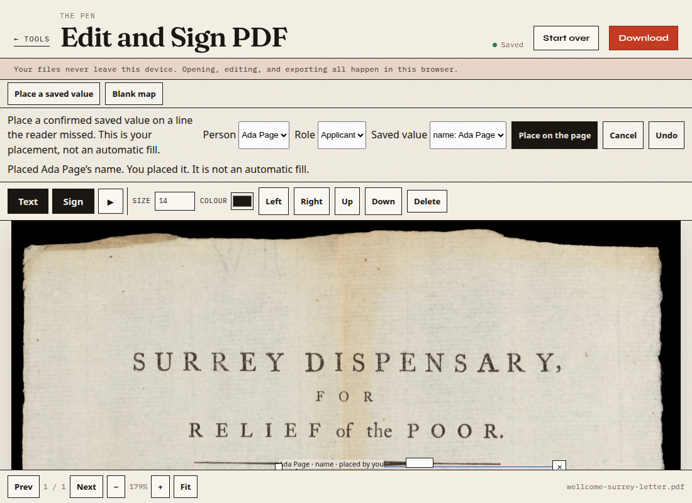

# Large photo ingestion

This is a resource and lifecycle check. It is not an accuracy audit and it does not add writable targets. The 13-target development score stays 0/13. The food-order glyph still misses the frozen name box by 1 source pixel. That miss was measured again and was not turned into a pass.

## What was measured before the change

Chrome headless, one image at a time. `performance.memory.usedJSHeapSize` is the page’s JavaScript heap only. On a blank page it stayed at 86,400,000 across a full decode of the Surrey JPEG, so that counter does not include the decoded bitmap. No process RSS figure is used here, and this is not a phone result.

| Step | Result |
| --- | --- |
| Surrey JPEG, 3,714,161 bytes, SHA-256 `688174810ea3abd4dcb65c4f5c2af0c297c246ff2f3e3d682aa768c04996d03a` | 4842×5964. An RGBA buffer of those pixels is 115,510,752 bytes. |
| `createImageBitmap` of that file | 4842×5964 in 490 ms. The page then held the full bitmap. |
| Same call asked to resize to 1500×1848 | Returned 1500×1848. An RGBA buffer of that bitmap is 11,088,000 bytes. |
| Current `readImage`, before the orientation change | 3725 ms, 0 fields, working sheet 1500×1848, then a −0.1° straighten to 1503×1851. The returned frame had no original pixel size. The tall upright sheet in that same pass was turned −1.7°. That turn is no longer applied. See `ORIENTATION.md`. |
| Flat JPEG, long edge 8192, 16384, and 32768 | Each resized at decode. 32768 is the longest edge that completed. |
| Canvas element 20000×20 | The element accepted that size. That is not an image-decode limit. |

The width cap of 1500 left height unbounded. A 400×3000 photo would have been read at full height. A failed or replaced upload left the previous form in place, so Place a missing line could still open it.

## Limits now in the reader

JPEG and PNG headers are read before decode. EXIF orientation 5–8 swaps the stored width and height. The reader stops, and does not call `createImageBitmap`, when the oriented edge is over 32768 or the oriented pixel count is over 4842×5964. The message names the size and says the file was not decoded.

Below that ceiling, a photo whose width is over 1500 or whose height would be over 1850 is decoded at that working size. 1850 is one pixel past the 1848-tall Surrey sheet, so that sheet is unchanged, and the food-order working file at 983×1600 is unchanged. The frame records `sourceW` and `sourceH` in oriented pixels. The status says the original size and the reduced size.

A new form clears the previous bytes, fields, and proposals before the read. A corrupt image leaves the desk empty. Clear during a read, or a later file, drops the in-flight result. An empty draft replaces the saved form so a reload does not bring the old document back. Scan autofill stays off. Line thresholds were not changed.

## Checks

Chrome headless. `large-image.mjs`: 14 checks, 0 failed. Raw file: `results/large-image.json`.

| Check | Result |
| --- | --- |
| Red mark on a 2400×1800 JPEG, reduced to 1500×1125 | Mapped center was 0.76 source pixels from (819.5, 619.5). |
| 400×3000 photo | Source size kept. Working height 1850. Aspect held. The reader also turned it −1.7°. |
| Corrupt JPEG after a good photo | Previous form cleared. Placement disabled. |
| JPEG and PNG headers of 40000×40000 | Refused in 5 ms. Not decoded. |
| PNG 480×240 | Frame stores 480×240. |
| EXIF orientation 6 | Oriented frame 480×240. The sheet is wide. |
| Native PDF | Export still contains `KEEP-ORIGINAL` and 1 widget. |
| Open and clear, twice | No form left to place. |
| Surrey read replaced by a small JPEG | The small sheet remains. Placement was disabled while Surrey was reading. |
| Clear during the Surrey read | The Surrey sheet does not appear. |
| Surrey through the page | 3015 ms. 0 lines. Status names 4842×5964 reduced to 1500×1848. |
| Fictional “Ada Page” on that sheet | Export baseline is 0.0002 pt from the click. The click round-trips through the frame with error 0. |

`usedJSHeapSize` in that page after the Surrey read was 28,458,026. That is still only the JavaScript heap.

The same head reran the coordinate ledger, `frame-anchor.mjs` (0 failed, including geometry 0/13 and the food-order strict miss of 1 source pixel), `recover-e2.mjs` (0 failed, 38 steps), and `template-e3.mjs` (0 failed, 36 steps).

## Picture

Surrey Dispensary blank discharge form letter, eighteenth century. Wellcome Collection. https://wellcomecollection.org/works/qsrdg5qx. CC BY 4.0, https://creativecommons.org/licenses/by/4.0/. The screenshot is a resized, cropped use of that JPEG with the fictional name Ada Page added in the editor. It is not a field score.

## Not claimed

No phone. No current Chrome stable. No second reviewer. The 32768-edge files were flat synthetic JPEGs, not photographs. Memory inside the image decoder, the GPU, and the worker is not in `usedJSHeapSize`. A photo larger than 4842×5964 is refused even if a later browser could open it. The −1.7° turn on the tall synthetic sheet is the existing line score, not a new detector setting.
