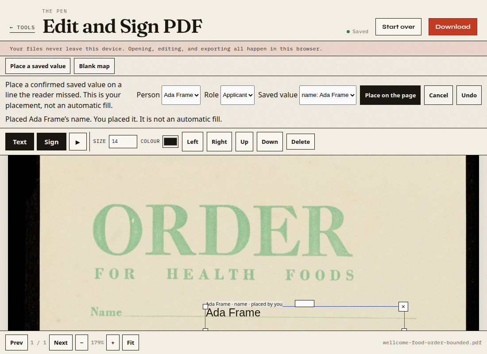

# First look at archival blank paper

This is a development diagnostic, not an audit and not a reliability rate. The annotations are a provisional single-review gold: one pass over the images, no second reviewer. They were written down before the detector ran.

The review-transport measurements in `SCAN-TRANSPORT.md` are a different cycle and are not reused as evidence here.

## What was in the handoff

Archive SHA-256 `a5113076f3d3fedcc6c9225f2ae0d7aa66d6668cee659d19f8739286d4a0cb35`, 6,244,603 bytes. Eight unmodified publisher JPEGs. No field gold was supplied. No EXIF. The capture device is not documented. These are not modern phone photographs.

Three issuer/era clusters only: 1950 Census (six images, public-vendoring hold), the Fortnum food order, and the Surrey letter. The Surrey page was not opened in the product. It is about 28.9 megapixels. One RGBA buffer of that size is on the order of 115 MB before OCR. The food order was resized for the product run.

| Working file | Source pixels | Pixels given to the reader | Scale back to the source |
| --- | --- | --- | --- |
| Food order | 3442 × 5601 | 983 × 1600 | multiply x by 3442/983 and y by 5601/1600 |
| Census P5 | 924 × 1200 | the same file | 1 |
| Census P8 | 1200 × 804 | the same file | 1 |

The food-order resize is a uniform scale. Source boxes below are in the original JPEG. Census images, crops, and screenshots of them stay out of this repository.

## Provisional targets

Frozen file SHA-256 `124e7b9370469699215f2ebdd1d1d5b6892209d0b7654453a64e614b675a437e`. Thirteen writable boxes. Checkbox corners on P5 were not locked, so those boxes are outside the denominator. Demographic checkboxes and signature lines on P8 are ignored for filling.

Food order, CC BY 4.0. Order for health foods, Fortnum & Mason (Firm), 1930–1939. Wellcome Collection. https://wellcomecollection.org/works/yyd5czyz. https://creativecommons.org/licenses/by/4.0/. The boxes are a measurement on that image, not the publisher’s file unchanged.

| Id | Role | Original box, top-left origin |
| --- | --- | --- |
| Name | customer | 820, 1295, 3040, 1362 |
| Address | customer | 870, 1510, 3040, 1578 |
| Quantity, article, price | line item, row 1 | three cells under the header |
| Quantity, article, price | line item, row 2 | the next row |

Seventeen ruled item rows were counted. Only the first two are in the denominator. P5 contributes the date, location, and service-serial lines (3). P8 contributes the name cell on person row 1 and person row 2 (2). P5 and P8 are the same Census cluster, not two independent audits.

## Baseline, before the copy change

Geometry hit means the suggestion center falls in the writable box, expanded by 12 source pixels, or the overlap is at least 0.1. A right string in the wrong box would fail. Label hit also requires the suggestion’s kind or first label word to match. Suggestions are not scored against source pixels when the reader turns the page.

| Page | Time | Suggestions | Geometry | Label | Notes |
| --- | --- | --- | --- | --- | --- |
| Food order | 2366 ms | 0 | 0 / 8 | 0 / 8 | No turn. The black border was cropped (16, 40, 913 × 1516 on the working image). |
| P5 | 4014 ms | 2 | not scored | 0 / 3 | Turned 0.3°. Neither label was Date, Location, or the serial line. Both kinds were other, so they are not autofill. |
| P8 | 5639 ms | 0 | 0 / 2 | 0 / 2 | No turn. |

The same three reads after the copy change were 2355 ms, 3996 ms, and 5645 ms, with the same counts: 0, 2, and 0. That is a development regression on these files, not a new audit.

Uploading the food-order photo then said “Form ready.” Place a missing line tried to open the JPEG as a PDF and stopped with “No PDF header found.” Nothing could be placed.

## Scored through the deskew

The first table left P5 unscored because the reader turned the page 0.3°. That skip is withdrawn. A suggestion is mapped back through the same turn and crop the reader used, then compared with the frozen source box. The pad is 8 source pixels, the uncertainty already written down for rule edges. The box must sit inside the target. A center that merely falls between two labels is not a hit, and a matching string does not rescue a missed box. The pad was not raised. The boxes were not moved after the detector ran.

A 0.3° round trip of a dot was checked in the browser before the pages were scored. The mapped center came back within 2 pixels (0.65 and 0.19).

| Page | Suggestions | Angle | Geometry | Label |
| --- | --- | --- | --- | --- |
| Food order | 0 | 0 | 0 / 8 | 0 / 8 |
| P5 | 2 | 0.3 | 0 / 3 | 0 / 3 |
| P8 | 0 | 0 | 0 / 2 | 0 / 2 |

P5’s two suggestions are in the distribution paragraph, below the three gold lines. Their kinds are other, so they are not autofill. The inverse of 0.3° moves a point by only a few pixels, which is not enough to reach y 678–845. The raw wording of those suggestions stays out of this file. Combined geometry on the 13 targets is 0 / 13. Thresholds were not changed. This is the same three files, not a new audit.

## What changed

A photo that produces no lines now keeps the status “No lines were found. Use Place a missing line to put a value where you want it. Nothing was written.” The disabled fill button no longer says it opens the editor. Place a missing line opens the PDF sheet the reader built when the upload itself is not a PDF. An upload that already is a PDF still opens that original.

On the same food-order photo, Place a missing line opened the sheet. A fictional confirmed name was placed by hand. No Census value was filled. No signature was read into a profile.

The earlier write-up said the export was on the name line because its origin was at 23% of the sheet, the name rule near 22%, and the address rule near 26%. That comparison is withdrawn. A point between the two labels is not evidence that the baseline sits on the rule.

The editor screenshot from that placement shows the opposite of the export. The printed Name word occupies screenshot rows 747–760. The placed ink occupies rows 772–788, below the word and above the Address word, which begins near row 815. The export of that same placement has the ink on the same rows as the Name word (export rows 263–274 against the word at 266–273). The screenshot and the export did not agree. The cause is the preview: the text box is at least 1.3 em tall, the click is the top of that box, and the preview was packing the glyphs at the bottom. Export places the baseline 0.85 em below the top. That export formula is the one the coordinate ledger locks, so the preview was changed to pack the glyphs at the top. The export formula was not moved to match the old screenshot.

## Anchor check after that preview change

The printed Name rule was measured from the working JPEG by the dark row in the stroke, to the right of the word Name, not by where the placed text landed. That stroke is source y 1365–1383, darkest at 1376. The frozen name box still ends at 1362. It was not extended to cover the stroke.

A new placement, fictional value “Ada Frame”, was clicked at 42% of the sheet width and 22% of its height, which is the top of the text box. The export text item maps through the reader’s frame (working image 983×1600, crop x 16 y 40, sheet 913×1516, no turn) to source box 1404, 1311, 1776, 1371. The baseline, 1371, lies in the measured stroke. The top of the glyphs, 1311, lies inside the frozen box. Strict containment of the whole glyph box fails by 1 source pixel: the bottom is 1371 and the box plus the 8 pixel pad ends at 1370. The pad was not raised and the box was not moved. The address box starts at 1510, so this is the baseline on the stroke, not a value dropped into the gap.

The editor’s text range on that sheet runs from 0.219 to 0.235 of the page height. The export baseline is at 0.232. The difference is 0.003 of the page. In the new screenshot the Name word is rows 701–714 and the placed ink is rows 697–714, so they overlap. The earlier screenshot’s rows do not.

These three pictures are a resized, cropped use of the Wellcome food-order JPEG, with a fictional name added in the editor. Attribution is above. They are not a claim about other forms.

The same run also placed a fictional name on a project JPEG, a PNG, and an EXIF orientation-6 JPEG (the sheet opened wide, aspect 3.58). Reload kept the line. Switching person cancelled an armed click. Opening another document dropped the previous line. A native PDF kept its original text and its one widget. Raw counts are in `results/frame-anchor.json`.

## Limits

Eight images, three clusters, all development. No phone. No gold from a second reviewer. Faint green rules and the Census name rows were missed; the thresholds were not changed to chase them. P5 is now scored through the 0.3° turn and still misses, 0 / 3. The food-order glyph box still sticks 1 source pixel past the padded name box because the baseline sits on the rule stroke and the frozen box ends just above that stroke. The Surrey letter was later opened as a resource case, not as another accuracy target. See `LARGE-IMAGE.md`. Chrome’s Load unpacked picker was not tried again. No current-Chrome and no phone result is claimed.
