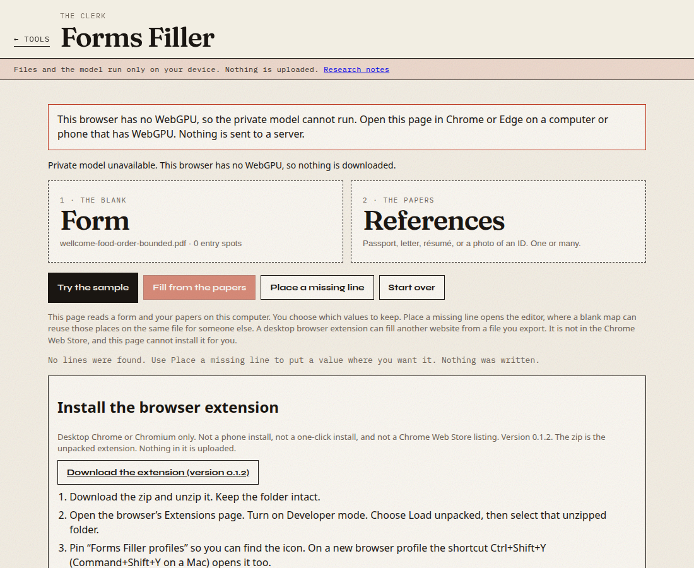
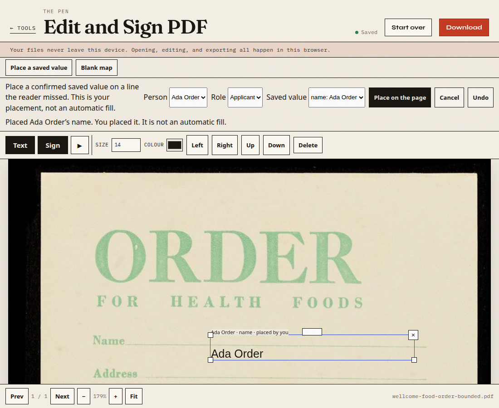
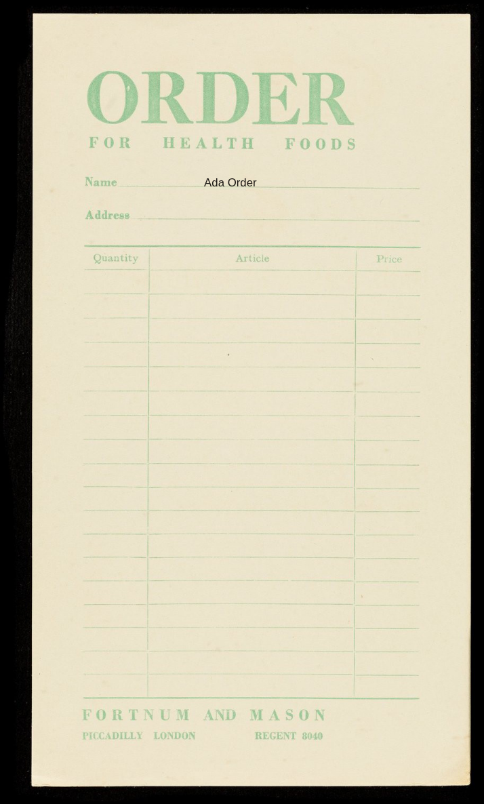

# First look at archival blank paper

This is a development diagnostic, not an audit and not a reliability rate. The annotations are a provisional single-review gold: one pass over the images, no second reviewer. They were written down before the detector ran.

The review-transport measurements in `SCAN-TRANSPORT.md` are a different cycle and are not reused as evidence here.

## What was in the handoff

Archive SHA-256 `a5113076f3d3fedcc6c9225f2ae0d7aa66d6668cee659d19f8739286d4a0cb35`, 6,244,603 bytes. Eight unmodified publisher JPEGs. No field gold was supplied. No EXIF. The capture device is not documented. These are not modern phone photographs.

Three issuer/era clusters only: 1950 Census (six images, public-vendoring hold), the Fortnum food order, and the Surrey letter. The Surrey page was not opened in the product. It is about 28.9 megapixels. One RGBA buffer of that size is on the order of 115 MB before OCR. The food order was resized for the product run.

| Working file | Source pixels | Pixels given to the reader | Scale back to the source |
| --- | --- | --- | --- |
| Food order | 3442 × 5601 | 983 × 1600 | multiply x by 3442/983 and y by 5601/1600 |
| Census P5 | 924 × 1200 | the same file | 1 |
| Census P8 | 1200 × 804 | the same file | 1 |

The food-order resize is a uniform scale. Source boxes below are in the original JPEG. Census images, crops, and screenshots of them stay out of this repository.

## Provisional targets

Frozen file SHA-256 `124e7b9370469699215f2ebdd1d1d5b6892209d0b7654453a64e614b675a437e`. Thirteen writable boxes. Checkbox corners on P5 were not locked, so those boxes are outside the denominator. Demographic checkboxes and signature lines on P8 are ignored for filling.

Food order, CC BY 4.0. Order for health foods, Fortnum & Mason (Firm), 1930–1939. Wellcome Collection. https://wellcomecollection.org/works/yyd5czyz. https://creativecommons.org/licenses/by/4.0/. The boxes are a measurement on that image, not the publisher’s file unchanged.

| Id | Role | Original box, top-left origin |
| --- | --- | --- |
| Name | customer | 820, 1295, 3040, 1362 |
| Address | customer | 870, 1510, 3040, 1578 |
| Quantity, article, price | line item, row 1 | three cells under the header |
| Quantity, article, price | line item, row 2 | the next row |

Seventeen ruled item rows were counted. Only the first two are in the denominator. P5 contributes the date, location, and service-serial lines (3). P8 contributes the name cell on person row 1 and person row 2 (2). P5 and P8 are the same Census cluster, not two independent audits.

## Baseline, before the copy change

Geometry hit means the suggestion center falls in the writable box, expanded by 12 source pixels, or the overlap is at least 0.1. A right string in the wrong box would fail. Label hit also requires the suggestion’s kind or first label word to match. Suggestions are not scored against source pixels when the reader turns the page.

| Page | Time | Suggestions | Geometry | Label | Notes |
| --- | --- | --- | --- | --- | --- |
| Food order | 2366 ms | 0 | 0 / 8 | 0 / 8 | No turn. The black border was cropped (16, 40, 913 × 1516 on the working image). |
| P5 | 4014 ms | 2 | not scored | 0 / 3 | Turned 0.3°. Neither label was Date, Location, or the serial line. Both kinds were other, so they are not autofill. |
| P8 | 5639 ms | 0 | 0 / 2 | 0 / 2 | No turn. |

The same three reads after the copy change were 2355 ms, 3996 ms, and 5645 ms, with the same counts: 0, 2, and 0. That is a development regression on these files, not a new audit.

Uploading the food-order photo then said “Form ready.” Place a missing line tried to open the JPEG as a PDF and stopped with “No PDF header found.” Nothing could be placed.

## What changed

A photo that produces no lines now keeps the status “No lines were found. Use Place a missing line to put a value where you want it. Nothing was written.” The disabled fill button no longer says it opens the editor. Place a missing line opens the PDF sheet the reader built when the upload itself is not a PDF. An upload that already is a PDF still opens that original.

On the same food-order photo, Place a missing line opened the sheet. The fictional confirmed value “Ada Order” was placed by hand on the name line. The export’s text sits at 23.2% of the sheet height. The name rule is near 22% and the address rule near 26%, so the value is on the name line. The address line was left blank. No Census value was filled. No signature was read into a profile.

The placed and export pictures are a resized, cropped use of the Wellcome food-order JPEG, with a fictional name added in the editor. Attribution is above. They are not a claim about other forms.

## Limits

Eight images, three clusters, all development. No phone. No gold from a second reviewer. Faint green rules and the Census name rows were missed; the thresholds were not changed to chase them. P5’s two stray suggestions were not given a source-pixel score because the page was turned 0.3°. The Surrey letter was not run. Chrome’s Load unpacked picker was not tried again.
