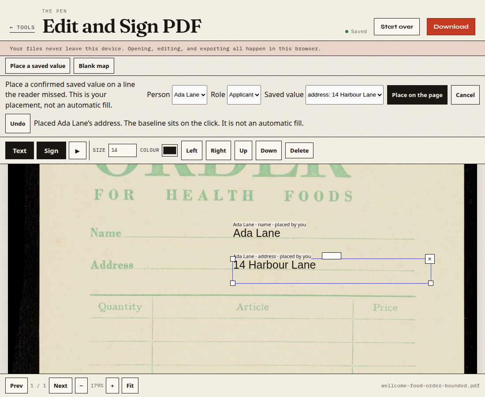
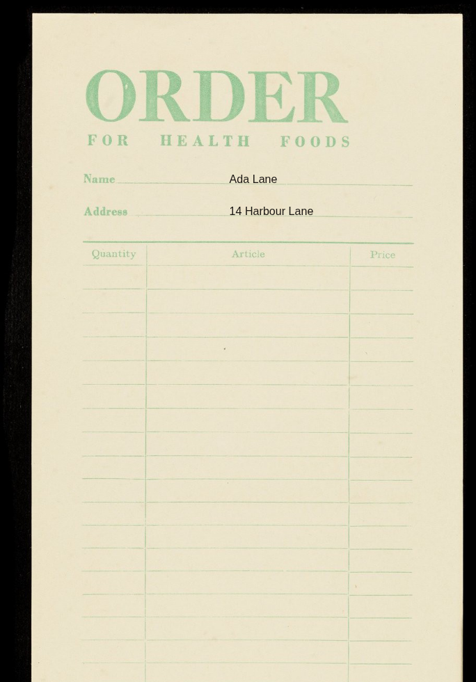

# Click is the baseline

A click on a printed rule used to store the top of the text box. The export baseline stays 0.85× the type size below that top, so the words landed below the rule. On a page with a rule at PDF y 500.6, that older click put the baseline at 488.71, 11.89 points below the rule. 0.85×14 is 11.9.

A new click now stores the box top 0.85× the type size above the click, so the existing baseline formula lands on the click. The formula itself is unchanged. Saved boxes and maps keep the tops they already stored. Applying a map does not add the shift again.

The 1 point inset in the rotation check is the existing left inset: the glyph starts 1 user unit in from the left edge of the box, along the writing direction. It is not a vertical nudge, and it was not chosen from the food-order boxes. On the ruled page the exported baseline was y 500.605 against the rule at 500.6.

## Ruled page

| Check | Result |
| --- | --- |
| Baseline of Peggy Jay on the 500.6 rule | y 500.605, type size still 14 |
| Long address | full string kept; export wraps “warehouse” 18.2 points below the first line |
| Zoom | stored top stayed 35.2898% |
| 2× device pixel ratio | baseline y 500.605 |
| Narrow viewport, 390 CSS pixels wide | type size stayed 14 |
| Click at the top edge | the page says the baseline could not sit on that click |
| Second person through the saved map | Bea Shore and 8 Pier Street; tops 35.2898%, 55.4918%, and 0% match the stored slots |
| Rotations 0, 90, 180, 270 and an offset crop | baseline matches the click plus the existing 1 point inset |

`template-e3.mjs` was rerun: 36 steps, 0 failed, including native widgets and an unconfirmed phone left blank. `draft-lifecycle.mjs`: 22 checks, 0 failed. The coordinate ledger passed. Photo map identity is unchanged.

## Food order

The file opened was the bounded development JPEG, 983×1600. The frozen targets are publisher pixels, 3442×5601. The clicks were the first two long rules on the rendered sheet, at 23.16% and 27.24% of its height. No nudge.

Mapped through the recorded sheet (crop x 16 y 40, 913×1516, then ×3442/983 and ×5601/1600):

| Glyph | Publisher box | Inside the pad of 8 |
| --- | --- | --- |
| Ada Lane | 1595.91, 1293.88, 1917.93, 1369.09 | yes; the bottom is 0.91 pixels inside the padded name limit |
| 14 Harbour Lane | 1595.91, 1510.43, 2160.36, 1585.63 | yes; the bottom is 0.37 pixels inside the padded address limit |

The editor and the export both show those words sitting on the Name and Address rules.

Order for health foods, Fortnum & Mason (Firm), 1930–1939. Wellcome Collection. https://wellcomecollection.org/works/yyd5czyz. https://creativecommons.org/licenses/by/4.0/. The fictional values Ada Lane and 14 Harbour Lane were added in the editor.

The earlier misses stay what they were: the manual glyph 1 source pixel outside the padded name box, and the later clicks 29 and 114 pixels outside. Those were different placements. The detector is still 0 of 13. This was not a detector run.

## Long lines

The editor now breaks lines with the same Helvetica widths as the export, at 1.3× the type size. Overflow stays visible. A long word is not cut or shrunk. A typed newline is kept in the file. On the ruled page, “14 Harbour Lane beside the long west” and “warehouse” are the two preview lines and the two export lines, 18.2 points apart. Peggy Jay’s baseline remains y 500.605 on the rule at 500.6. `wrap-lines.mjs`: 13 checks, 0 failed.
